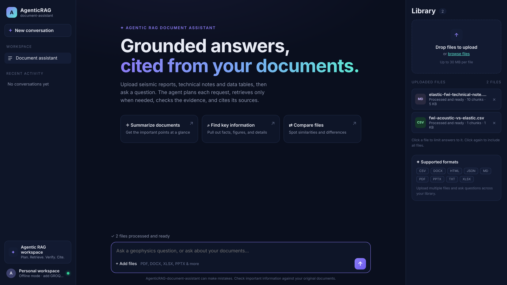
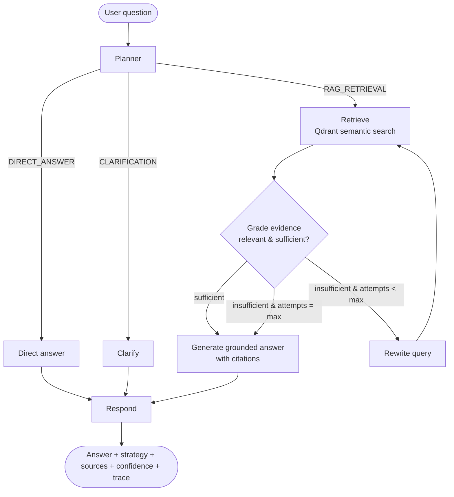

# AgenticRAG-document-assistant

**AgenticRAG-document-assistant is an Agentic RAG system that decides *how* to answer a question before answering it.**

Most RAG pipelines send every question to a vector database. This assistant first works out what the
user is asking for and picks a strategy: answer directly, retrieve from documents, or ask a
clarifying question. When it retrieves, it grades whether the evidence is relevant and
sufficient, rewrites the query if it isn't, and only then writes a grounded, cited answer.
When the documents don't contain the answer, it says so.

Built with **LangGraph, LangChain, FastAPI, Groq and Qdrant**. LangGraph runs the stateful
decision flow, Qdrant stores and searches the embedded document chunks, and Groq-hosted
models handle planning, grading and generation.



*A 2.5-minute demo recording (`AgenticRAG.mkv`) shows upload, routing and grounded answers end to end.*

---

## Features

- **Any question, any document:** before answering directly, the planner runs one quick search of your library; if the question matches indexed content, it retrieves instead, so you never need to name a file.
- **Intent-aware routing:** a planner node classifies each request as `DIRECT_ANSWER`, `RAG_RETRIEVAL` or `CLARIFICATION`, so general questions never touch the vector store.
- **Self-correcting retrieval:** an evidence grader checks relevance and sufficiency, and can rewrite the query and search again, with a hard retry limit.
- **Grounded, cited answers:** answers are generated only from graded chunks, with inline `[n]` citations linked to source cards showing document, page and similarity score.
- **Honest fallbacks:** if nothing relevant is found, the assistant says the documents don't cover it instead of guessing.
- **Live agent trace:** the UI streams each node's decision (Server-Sent Events), so you can see the planning and retrieval path.
- **Multi-format ingestion:** PDF, DOCX, XLSX, PPTX, CSV, TXT, MD, JSON and HTML are parsed, chunked, embedded and indexed. PDFs and slides keep page numbers.
- **Conversation memory:** recent turns are passed to the planner so follow-ups like *"what about international orders?"* resolve correctly.
- **Document scoping:** click files in the Library to restrict answers to them.
- **Runs anywhere:** embedded Qdrant (no Docker needed) or a Qdrant server/Cloud; local CPU embeddings via FastEmbed (no embedding API key).
- **Offline mode:** without a `GROQ_API_KEY`, the app still runs with heuristic routing and extractive answers, which is useful for testing the UI and ingestion.

## How it works



| Node | Responsibility |
|---|---|
| **Planner** | Classifies intent using the question, conversation history and library contents; writes a standalone search query for RAG |
| **Retrieve** | Embeds the query and searches Qdrant (optionally filtered to selected documents) |
| **Relevance / Sufficiency** (`grade`) | One LLM call marks which chunks are relevant, whether they're sufficient, and proposes a better query if not |
| **Rewrite** | Applies the grader's improved query (never repeats one already tried) and loops back to retrieval |
| **Generate** | Answers only from graded chunks with `[n]` citations; states clearly what isn't covered |
| **Direct answer / Clarify** | Answers from general knowledge, or asks one targeted follow-up question |
| **Response** (`respond`) | Returns answer, strategy, reasoning, confidence, sources, tried queries and the full trace |

LangGraph's conditional edges make the branching explicit, and its shared `AgentState`
carries the strategy, retry counter, retrieved and graded chunks, and an append-only trace
between nodes. See [docs/ARCHITECTURE.md](docs/ARCHITECTURE.md) for the design details, and [docs/PROJECT_PRESENTATION.md](docs/PROJECT_PRESENTATION.md) for a project overview with a LinkedIn post and README introduction.

### Example behavior

| User request | Agent's decision |
|---|---|
| "What is the capital of France?" | "This is general knowledge; no document retrieval is needed." |
| "What does Section 4.2 of the uploaded policy say about refunds?" | "This requires document context; retrieving relevant policy sections." |
| "Can Final Sale items be returned?" (no file named) | The library check finds matching content; retrieves the policy section and cites it |
| "What about international orders?" (follow-up) | Uses conversation history; retrieves the shipping and refund sections |
| "Summarize the uploaded research paper." | Retrieves and synthesizes document context |
| "Compare the refund terms in both uploaded contracts." | Retrieves from multiple documents and compares |
| "What about it?" (no prior context) | Asks a clarifying question |
| A question the documents don't cover | Says the available evidence is insufficient |

Sample documents are included in [`documents/`](documents/) so you can try these immediately:

- [`sample-refund-policy.md`](documents/sample-refund-policy.md): a short fictional customer policy with numbered sections
- [`sample-support-plans.csv`](documents/sample-support-plans.csv): a fictional support-plan comparison table

Any other file you upload works the same way, including PDF reports, Word documents and slide decks.

## Tech stack

| Layer | Technology |
|---|---|
| Backend | Python 3.10+, FastAPI, Uvicorn |
| Agent orchestration | LangGraph, LangChain |
| LLM inference | Groq (default `openai/gpt-oss-120b`; any Groq chat model, e.g. GPT-OSS) |
| Vector database | Qdrant (embedded, Docker, or Qdrant Cloud) |
| Embeddings | FastEmbed, `BAAI/bge-small-en-v1.5` (local CPU) |
| Document processing | pypdf, python-docx, openpyxl, python-pptx, BeautifulSoup |
| Frontend | HTML, CSS, vanilla JavaScript (served by FastAPI) |

## Project structure

```
AgenticRAG-document-assistant/
├── backend/
│   ├── main.py              # FastAPI app: REST + SSE endpoints, serves the frontend
│   ├── config.py            # Settings from environment / .env
│   ├── agent/
│   │   ├── graph.py         # LangGraph workflow and conditional edges
│   │   ├── nodes.py         # Planner, retriever, grader, rewriter, generators, responder
│   │   ├── state.py         # Shared agent state
│   │   ├── prompts.py       # Prompt templates
│   │   └── llm.py           # Groq model factory + offline fallback
│   ├── retrieval/
│   │   ├── embeddings.py    # FastEmbed (default) and hash embedder (tests)
│   │   ├── qdrant_client.py # Qdrant connection and collection setup
│   │   └── retriever.py     # Upsert, search, delete, document registry
│   └── ingestion/
│       ├── loaders.py       # Text extraction per file type
│       ├── chunker.py       # Recursive chunking with page metadata
│       └── indexer.py       # Extract → chunk → embed → index
├── frontend/                # index.html, styles.css, app.js
├── documents/               # Uploaded files + a sample policy
├── eval/                    # Routing/retrieval evaluation set and runner
├── scripts/ingest.py        # Bulk-ingest files or folders from the CLI
├── tests/                   # Offline pytest suite
├── docs/                    # Architecture notes, LinkedIn post, screenshots
├── Dockerfile · docker-compose.yml · render.yaml
├── run.bat · run.sh         # One-command local start
├── requirements.txt · requirements-dev.txt · .env.example
└── README.md
```

## Getting started

### Prerequisites

- Python 3.10 or later
- A [Groq API key](https://console.groq.com) (optional for offline mode)
- Docker only if you want a Qdrant server; the default embedded Qdrant needs nothing extra

### Quick start (Windows)

Double-click **`run.bat`**. It creates a virtual environment, installs dependencies, copies
`.env.example` to `.env`, and opens http://127.0.0.1:8000. Then put your `GROQ_API_KEY` in
`.env` and restart.

### Quick start (macOS / Linux)

```bash
./run.sh
```

### Manual setup

```bash
git clone https://github.com/hmoubarak72/AgenticRAG-document-assistant.git
cd AgenticRAG-document-assistant
python -m venv .venv
source .venv/bin/activate          # Windows: .venv\Scripts\activate
pip install -r requirements.txt
cp .env.example .env               # Windows: copy .env.example .env
# edit .env and set GROQ_API_KEY
uvicorn backend.main:app --reload
```

Open **http://localhost:8000**. The API docs are at http://localhost:8000/docs.

The first upload downloads the embedding model once (about 130 MB). Never commit your `.env` file or API keys.

### Using a Qdrant server instead of embedded mode

```bash
docker run -p 6333:6333 qdrant/qdrant
# then in .env
QDRANT_URL=http://localhost:6333
```

Or run the app and Qdrant together:

```bash
docker compose up --build
```

## Configuration

All settings live in `.env` (see [`.env.example`](.env.example)). The main ones:

| Variable | Default | Purpose |
|---|---|---|
| `GROQ_API_KEY` | empty | Enables LLM planning/grading/generation; empty = offline mode |
| `LLM_MODEL` | `openai/gpt-oss-120b` | Answer model |
| `ROUTER_MODEL` | = `LLM_MODEL` | Optional faster model for planner and grader |
| `QDRANT_URL` | empty | Qdrant server URL; empty = embedded store at `QDRANT_PATH` |
| `EMBEDDING_MODEL` | `BAAI/bge-small-en-v1.5` | FastEmbed model (changing it requires a new collection) |
| `TOP_K` | `6` | Chunks retrieved per search |
| `MAX_RETRIEVAL_ATTEMPTS` | `2` | Retrieval attempts before answering with what's available |
| `PROBE_LIBRARY` | `true` | Search the library before answering directly, so questions about your documents are answered from them |
| `CHUNK_SIZE` / `CHUNK_OVERLAP` | `1000` / `150` | Chunking parameters (characters) |

## API

| Method | Endpoint | Description |
|---|---|---|
| `GET` | `/health` | Backend status, active model, document count, supported formats |
| `POST` | `/upload` | Upload and index one or more files (`multipart/form-data`, field `files`) |
| `GET` | `/documents` | List indexed documents |
| `DELETE` | `/documents/{doc_id}` | Remove a document and its vectors |
| `POST` | `/chat` | Ask a question; returns the full result |
| `POST` | `/chat/stream` | Same, as Server-Sent Events: `step` events per node, then `result` |

```bash
curl -F "files=@documents/sample-refund-policy.md" http://localhost:8000/upload

curl -X POST http://localhost:8000/chat \
  -H "Content-Type: application/json" \
  -d '{"question": "What does Section 4.2 of the uploaded policy say about refunds?"}'
```

Request body: `question` (required), `history` (list of `{role, content}`), `doc_ids` (optional list to scope the search).

Response shape:

```json
{
  "answer": "Approved refunds are issued to the original payment method within 7 business days ... [1]",
  "strategy": "RAG_RETRIEVAL",
  "reasoning": "This requires document context; retrieving relevant policy sections.",
  "confidence": "high",
  "sources": [
    {"index": 1, "document": "sample-refund-policy.md", "page": null,
     "chunk_id": "c16fcc9bca28bf1d-1", "score": 0.81, "snippet": "4.2 Refunds. Approved refunds ..."}
  ],
  "trace": [{"node": "planner", "detail": "Strategy: RAG_RETRIEVAL. ..."}, "..."],
  "queries": ["refund policy section 4.2"],
  "latency_ms": 1240
}
```

*(Values above are illustrative.)*

Confidence is derived from the grader: `high` when evidence was sufficient on the first
search, `medium` when it took a rewrite, `low` when the retry limit was reached without
sufficient evidence, and `n/a` for direct answers and clarifications.

## Testing and evaluation

```bash
pip install -r requirements-dev.txt
pytest -q                          # offline: in-memory Qdrant, hash embeddings, no API key
python -m eval.run_eval            # with your .env models
python -m eval.run_eval --offline  # heuristic router, no keys
```

The test suite covers routing, the retry limit, query rewriting, ingestion for each format,
upload/delete, and the streaming endpoint. `eval/run_eval.py` reports routing accuracy,
evidence hit rate, retry rate and median latency against `eval/routing_cases.jsonl`. The set
is deliberately small (16 cases) and is a starting point, not a benchmark. The offline
heuristics were written alongside it, so offline scores aren't meaningful; run it with your
Groq models to measure the real planner and grader.

## Why this matters: standard RAG vs. agentic RAG

A standard RAG pipeline follows one fixed path:

```
Question ──► Vector search ──► LLM answer
```

That works for many questions, but it spends a retrieval call on every greeting and general
question, and it will happily write an answer from chunks that are only loosely related.

AgenticRAG-document-assistant adds decisions at the points where a fixed pipeline fails:

- It **skips retrieval** when the question doesn't need private documents.
- It **retrieves** when document-specific knowledge is required, using a standalone query that resolves follow-ups.
- It **checks the evidence** before answering, and retries with a better query when it's weak.
- It **grounds and cites** answers in the chunks it actually used.
- It **acknowledges gaps** instead of inventing an answer.

The result is an assistant that is more transparent, spends fewer unnecessary calls, and is
better suited to real document workflows like policies, contracts, manuals and research.

The next step for AI applications is less about larger models and more about better architecture: systems that plan, check their own evidence and know when not to answer. New tools, data sources, memory and evaluation can be added as nodes in the same graph.

## Roadmap

- [x] Intent routing (direct / retrieval / clarification)
- [x] Relevance grading with query rewriting and retry limit
- [x] Inline citations linked to source cards
- [x] Streaming agent trace
- [x] Conversation memory for follow-ups
- [x] DOCX, XLSX, PPTX, CSV, TXT, Markdown, JSON and HTML support
- [x] Evaluation harness for routing and retrieval
- [ ] Hybrid retrieval (dense + sparse/BM25) and a reranker
- [ ] Token streaming for generated answers
- [ ] Structured multi-document comparison tables
- [ ] OCR for scanned PDFs
- [ ] Larger evaluation set with groundedness and citation-accuracy scoring
- [ ] Tool-using planner (summarize, extract tables, compare) and web-page ingestion
- [ ] Authentication and per-user document collections

## Contributing

Contributions are welcome. Please open an issue first to discuss major changes, then submit a
pull request with a clear description and passing tests.

## License

MIT © 2026 Hesham Moubarak. See [LICENSE](LICENSE).

## Acknowledgements

Built with open-source tools including LangGraph, LangChain, FastAPI, Qdrant, FastEmbed and Groq.
